# OpenMoHAA Android

English · **[Português (Brasil)](README.pt-BR.md)**

**Medal of Honor: Allied Assault** on Android, for handhelds with physical controls, on the
free [OpenMoHAA](https://github.com/openmoh/openmohaa) engine. It comes with its own
launcher, which installs the game straight from the GOG installer, on the device itself: no
computer needed.

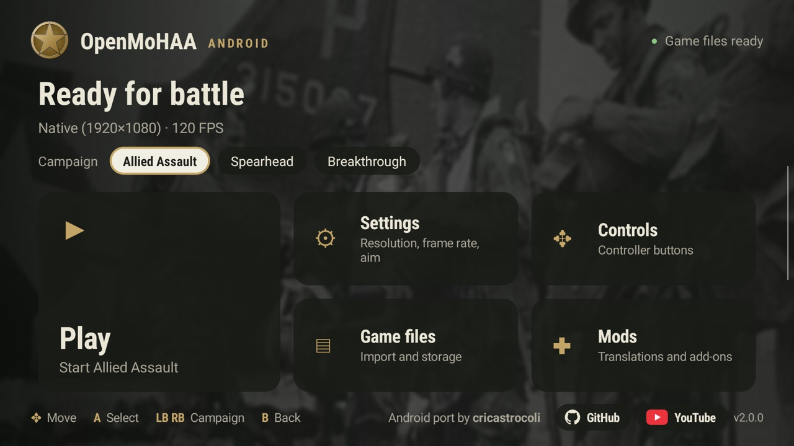

> The game's files are **not** included. You need your own copy of the original game
> (for example [Medal of Honor: Allied Assault War Chest on GOG](https://www.gog.com/en/game/medal_of_honor_allied_assault_war_chest)).

## Highlights

🆕 marks what's new in 2.0.

- 🆕 **Online and LAN multiplayer**: browse the internet servers (over 200 listed), join a
  match, or host one on your local network for another device.
- 🆕 **Aim assist** (campaign only, optional): the crosshair slows down and follows an enemy
  when it passes over one, with a light nudge toward the chest. You still do the aiming.
- 🆕 **Gyro aiming**: turn or tilt the device to aim. On by default when there's no
  controller.
- 🆕 **Aspect ratio**: widescreen, **menus in 4:3** (menus and videos unstretched, play in
  widescreen) or 4:3, like the original on a CRT.
- 🆕 **Graphics presets** (low to very high), a **bigger HUD** for small screens and a
  **scanline filter**.
- 🆕 **Export saved games** to carry them to another device or a PC.
- 🆕 **On-screen keyboard** in the game (Select + Start, or a button with touch controls), for
  player names, server addresses and the console.
- **Install straight from the GOG installer, on the device.** Download the Windows installer
  (the `setup_….exe` and its `.bin` files), pick them in the launcher, done: the app extracts
  the game by itself. On a Retroid Pocket 6 this takes about **70 seconds** for all three
  games (2.7 GB).
- **Up to 120 FPS** on 120 Hz screens.
- **Touch controls** for phones without a controller, **remappable buttons**, refined analog
  aiming, **mods and translations**, and the M1 Garand that **reloads at any time**
  (optional).
- Allied Assault, Spearhead and Breakthrough in one app, all three tested, on 16:9 and 4:3
  screens.

<p>
  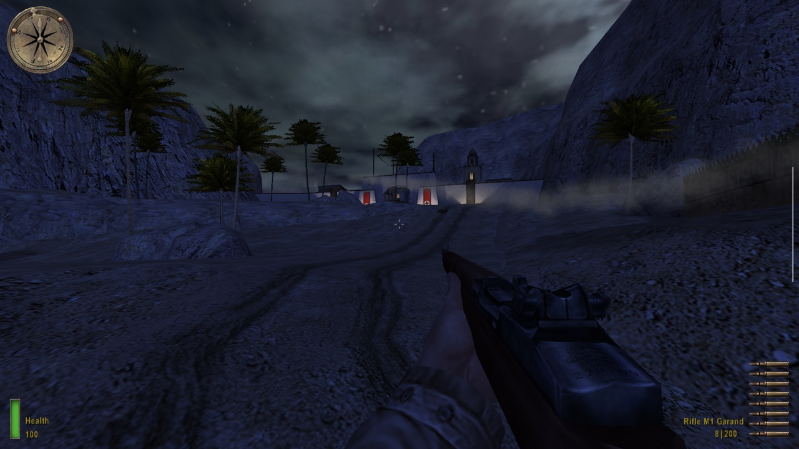
  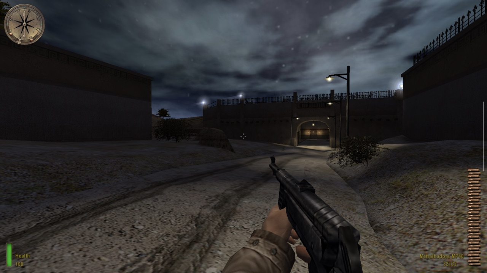
  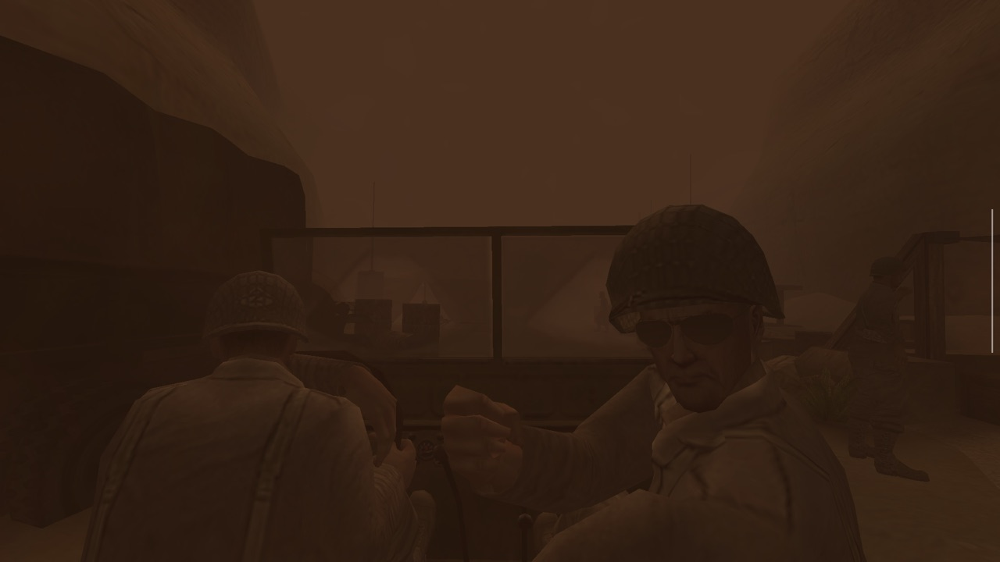
</p>

*Running on a Retroid Pocket 6 (with the Brazilian Portuguese translation mod).*

<p>
  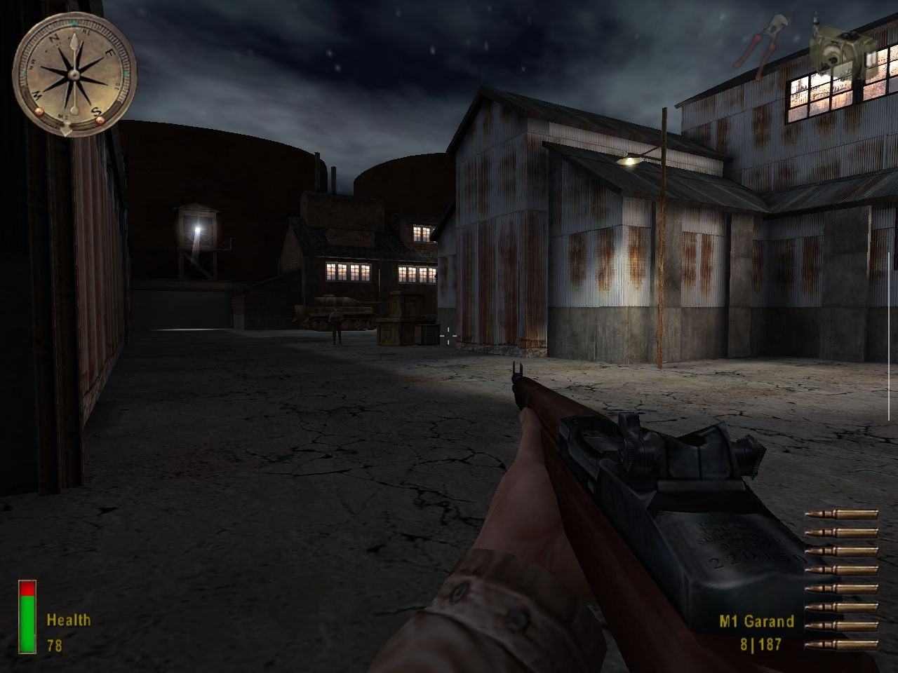
  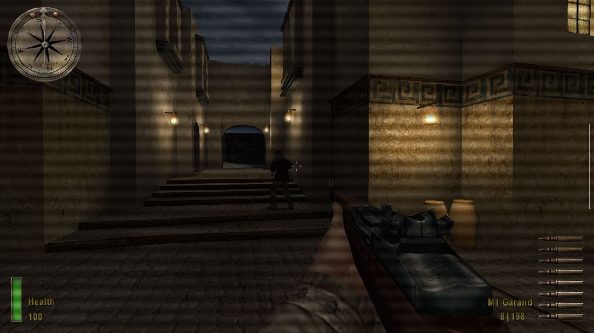
</p>

*Left: on a Retroid Pocket Nova (4:3). Right: the light scanline filter.*

## Multiplayer

🆕 The game's own multiplayer menus work: **Join Internet Game** lists the servers from the
community master servers (the original GameSpy ones are long gone), and **Join LAN Game**
finds matches on your network. To host one, use **Start Game** in the multiplayer room and
leave **Dedicated server** unticked (a dedicated server has no player, so on a handheld the
screen just stops).

<p>
  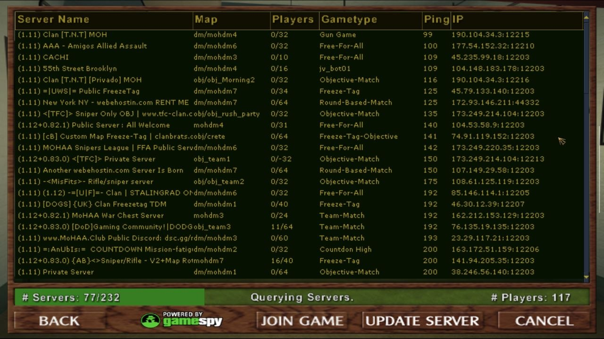
  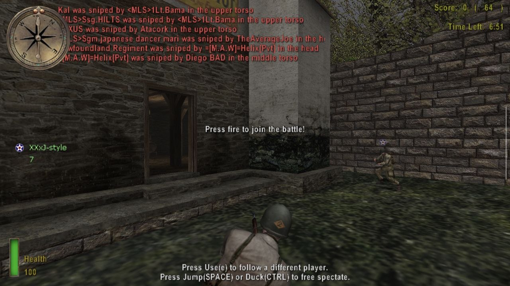
</p>
<p>
  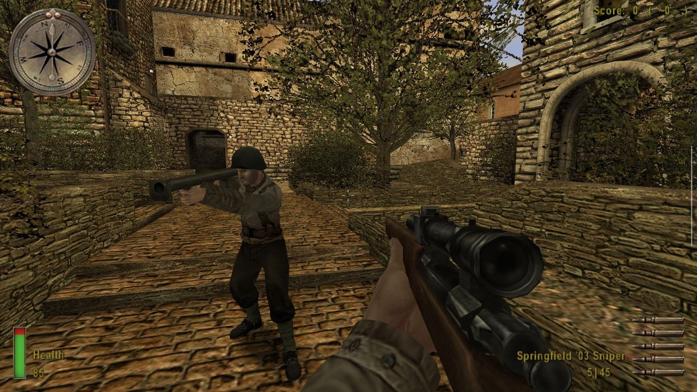
  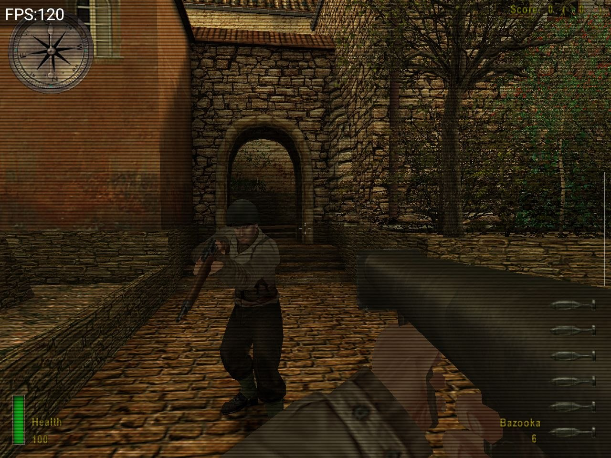
</p>

*A LAN match between a Retroid Pocket 6 (left) and a Retroid Pocket Nova (right).*

Aim assist never works in multiplayer.

## New in this port

Everything below was made for this Android version:

### Launcher

- Home page with the chosen campaign, a summary of the settings and a background picture from
  a mission briefing, taken from your own game files.
- Fully usable with a controller (D-pad, A, B, LB / RB), and by touch.
- English and Brazilian Portuguese, following the device's language.
- Credits when the game starts.
- Updates from inside the app (from 1.2.1 on): when a new version is out, the home page says
  so; one tap downloads it and Android asks you to confirm the update (the first time, also to
  let the app install updates). Your game files, saves and settings stay. It checks this
  project's GitHub release page at most once a day; nothing about you or your device is sent.

### Game files


- **GOG installer** (`setup_….exe` + `.bin`): extracted on the device with
  [innoextract](https://constexpr.org/innoextract/). Only the game's data folders (`main`,
  `mainta`, `maintt`) are taken. The app checks the free space first and tells you if a part
  of the installer is missing.
- The folder of an installed game (copied from a PC, for example).
- A `.zip` of the game's folder (or of its `main` folder).
- Importing again skips what is already there, so an interrupted import picks up where it
  stopped.
- **Import saved games** from a PC or another device: the `.sav` files (with their `.ssv`
  and `.tga`), or a `.zip` of the `save` folder. A zip's `main`, `mainta` or `maintt` folders
  send each save to the right game.
- 🆕 **Export saved games**: every campaign's saves in one `.zip`, saved where you choose. It
  imports on another device, or unpacks into OpenMoHAA's folder on a PC.

### Settings


| Option | Values |
|---|---|
| Game | Allied Assault, Spearhead, Breakthrough (the installed ones) |
| **Video** | |
| Resolution | Native, or 900, 720 or 540 lines (the width follows the screen's shape) |
| 🆕 Aspect ratio | Widescreen, **menus in 4:3**, 4:3 (4:3 screens start on 4:3) |
| 🆕 Graphics quality | Custom (the game's menus), low, medium, **high**, very high |
| Frame rate | 30, **60** (default), 90, **120**, unlimited |
| 🆕 HUD size | 100%, **125%** (default), 150% |
| 🆕 Scanline filter | **Off**, light, medium, strong |
| **Gameplay** | |
| 🆕 Aim assist | On / **off** (campaign only) |
| Aim speed | 50% to 150% |
| 🆕 Gyro aiming | **Automatic** (medium without a controller, off with one), off, low, medium, high |
| Invert vertical aim | On / off |
| Reload the rifle at any time | On / **off** (default) |

- 🆕 **Aim speed feels the same on any screen shape**: the game shows more to the sides on
  wider screens, so the turn rate is adjusted for the picture's aspect ratio (16:9 being the
  reference).
- 🆕 **Graphics presets** set texture detail and filtering, level of detail, shadows,
  effects, decals and smoke. A new install starts on High (the game's defaults); if you
  already played, Custom keeps what you set in the game's own menus.
- 🆕 **Menus in 4:3**: the game's menus and videos were drawn for 4:3 and stretched on wide
  screens; this draws them in a 4:3 area with black sides, and play stays widescreen.

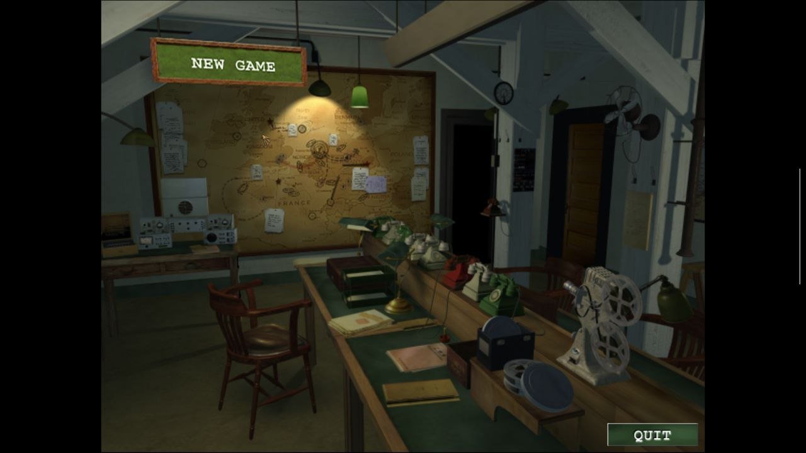

### Controls

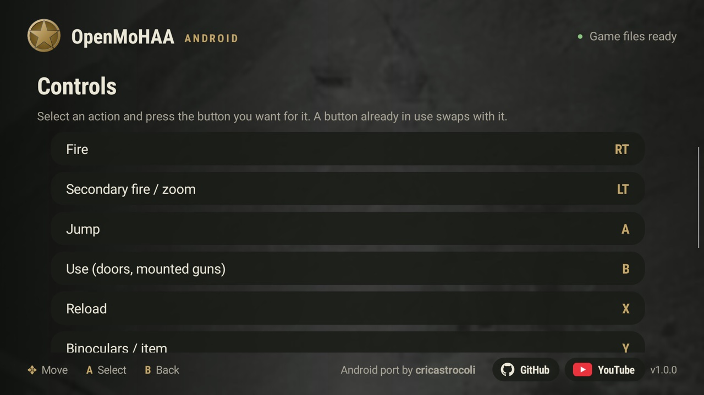

Defaults (every button can be changed on the **Controls** page):

| Button | Action |
|---|---|
| Left stick | Move |
| Right stick | Aim / look |
| RT | Fire |
| LT | Secondary fire / aim |
| A | Jump |
| B | Use (doors, mounted guns) |
| X | Reload |
| Y | Binoculars / item |
| LB / RB | Previous / next weapon |
| L3 | Crouch (press once to crouch, again to stand) |
| R3 | Walk (on / off) |
| D-pad ↑ | Grenade |
| D-pad ↓ | Holster weapon |
| D-pad ← / → | Lean left / right |
| Start | Menu |
| Select | Objectives |
| Select + LB / Select + RB | Quick save / quick load |
| 🆕 Select + Start | On-screen keyboard (open / close) |
| Android Back button | Menu |

Crouch and walk are **toggles** rather than held, which is easier on a handheld.

In the game's menus the sticks move the pointer, **A** clicks, **B** / **Start** go back and
the D-pad works as the arrow keys. After a level loads, the pointer is already on the
**Continue** button.

### Mods and translations

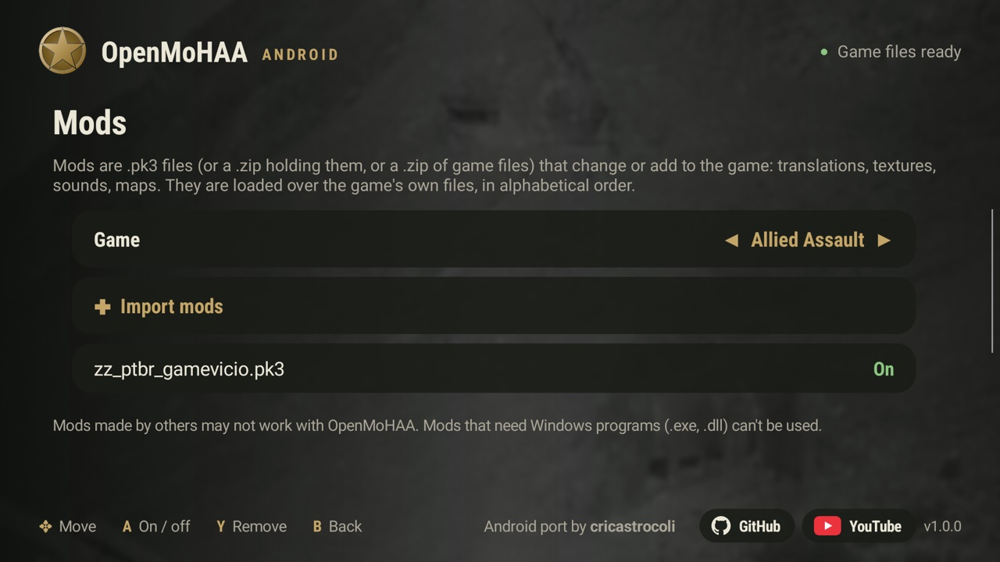

- Import `.pk3` files, a `.zip` holding `.pk3` files, or a `.zip` of a mod's loose files
  (`global/`, `textures/`, `sound/`…). Zips laid out as `MyMod/main/…` work too: the launcher
  sorts the folders out, and each expansion's part (`mainta/`, `maintt/`) goes to the right
  game.
- Switch each mod on and off (A) or remove it (Y).
- Mods load over the game's files, in alphabetical order.

### Fixes in the game

- 🆕 Online play: the server browser no longer crashes the game, and it lists servers again.
- 🆕 Switching a mod off really turns it off (the engine kept loading switched-off files).
- 🆕 The HUD on 4:3 screens is the same size as on 16:9 ones.
- Saving: when the game can't save (no space, for example), it says so, instead of showing
  "Game saved" anyway.
- The game's message boxes are larger and readable on small screens.

## Touch controls

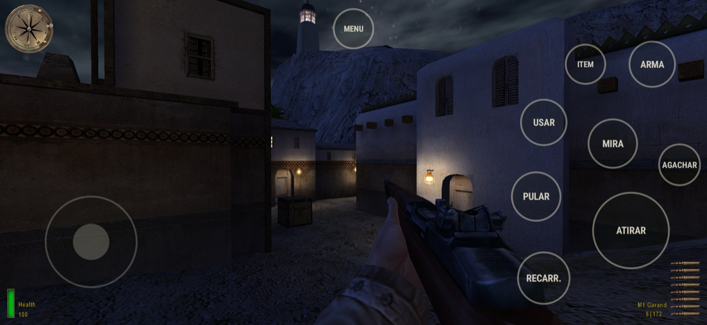

For playing on a phone without a controller. By default (**Automatic**) the on-screen controls
show only while no controller is connected: plug one in or pair it, even mid-game, and they
go away. Change it on the **Controls** page: Automatic, **Always** or **Never** (the screen
ignores touches, so a stray touch does nothing).

- **Move:** the left part of the screen; a stick appears where your thumb lands.
- **Aim:** drag anywhere on the right part, including from the buttons. Slow drags are
  precise; fast swipes turn faster, for quick turns. 🆕 With **gyro aiming**, turning the
  phone fine-tunes the aim.
- **Buttons:** fire and aim (held), reload, jump, crouch, use, weapon (which also picks
  the grenade), item and menu.
  Fire, aim and jump act as soon as they are touched; the others act on a tap, and a drag
  that starts on them turns the view instead.
- 🆕 **Keyboard:** the button at the left edge opens Android's keyboard (it moves clear of a
  front camera in the screen).
- **Menus:** tap what you want, as on any app (also with a controller connected, unless
  touch is set to Never). 🆕 Without a controller, the launcher's pages have a back button.

A controller is still the best way to play: aiming with a stick is more precise.

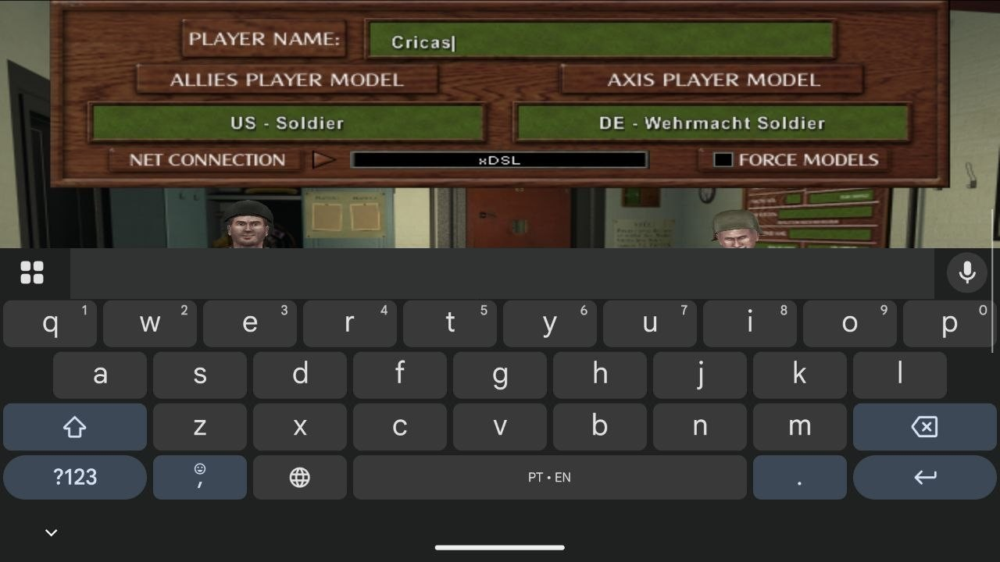

## Requirements

- Android 8.0 or newer, 64-bit (arm64).
- A controller (built into the device, USB or Bluetooth) is recommended; on phones without
  one, the touch controls work.
- The original game files: the **GOG** version (War Chest, with both expansions) is the one
  tested.
- Free space: about 2.7 GB for the game and its expansions. To install from the GOG
  installer, the installer (about 2.5 GB) must be on the device while it installs; it can be
  deleted afterwards.

**Tested on:**

| Device | Chip | Result |
|---|---|---|
| Retroid Pocket 6 | Snapdragon 8 Gen 2 (QCS8550) | Native resolution (1080p), 120 FPS |
| Retroid Pocket Nova | Snapdragon 8 Gen 2 (QCS8550) | Native resolution (1280×960, 4:3), 120 FPS |
| Retroid Pocket 5 | Snapdragon 865 | Native resolution (1080p), steady 60 FPS |
| Samsung Galaxy S23 (Android 16) | Snapdragon 8 Gen 2 | Native resolution, 120 FPS; installed from the GOG installer in about 2 minutes |

Other devices with similar chips should work. Reports are welcome in
[Issues](../../issues).

## Installing

1. Download the latest `OpenMoHAA-Android-….apk` from [Releases](../../releases) and install it.
2. From your GOG account, download the **Windows** installer of *Medal of Honor: Allied
   Assault War Chest*: the `setup_medal_of_honor_….exe` and the `….bin` files. Keep them all
   in the same folder on the device (for example `Download`).
3. Open the app, go to **Game files → Import from files** and select **the `.exe` and all the
   `.bin` files** (touch and hold the first one to select several).
4. Wait for the bar to fill up, then press **Play**.

If you already have the game installed on a PC, you can also copy its folder (or a `.zip` of
it) to the device and use **Import from a folder** or **Import from files**.

> Android's folder picker doesn't let apps use the root of `Download` or of the storage (the
> "Use this folder" button doesn't show). Use a subfolder, such as `Download/MOHAA`, or select
> the files instead.

## Known issues

- Multiplayer has been tested on public servers, in a match hosted on a device and in LAN
  matches between two devices.

## Building from source

You need: the Android SDK with NDK 27.2.12479018 and CMake 3.31.6, JDK 17, `flex` and `bison`
(on macOS: `brew install flex bison`).

```bash
./scripts/fetch-sources.sh
```

```bash
cd android && ./gradlew assembleRelease
```

The APK lands in `android/app/build/outputs/apk/release/`. innoextract comes prebuilt in
`android/app/src/main/jniLibs/`; to build it again, run `native/build-innoextract.sh`.

The engine changes are on the
[`rp6-android`](https://github.com/cricastrocoli/openmohaa/tree/rp6-android) branch of the
OpenMoHAA fork.

## Credits

Android port by **cricastrocoli**, developed with the help of generative AI: **Claude**
(Anthropic) for the development, **DeepSeek** for reviewing the plan and the code.

This project only exists thanks to:

- **[OpenMoHAA](https://github.com/openmoh/openmohaa)**, by the OpenMoHAA team: the free
  engine that recreates Medal of Honor: Allied Assault.
- **[emileb](https://github.com/emileb/openmohaa)**: OpenMoHAA's Android changes, and the gl4es
  fork used here.
- **id Software** and **[ioquake3](https://ioquake3.org/)**: the Quake III Arena engine
  OpenMoHAA builds on.
- **[SDL](https://www.libsdl.org/)**, **[OpenAL Soft](https://openal-soft.org/)** and
  **[gl4es](https://github.com/ptitSeb/gl4es)** (ptitSeb): video, input, audio and OpenGL on
  Android.
- **[innoextract](https://constexpr.org/innoextract/)** by Daniel Scharrer, with Boost, bzip2
  and xz: the GOG installer import.
- zlib, libjpeg (Independent JPEG Group), libogg and libvorbis (Xiph.Org), libmad and Recast
  Navigation.

Details and licenses in [THIRD_PARTY_NOTICES.md](THIRD_PARTY_NOTICES.md).

📺 The project on YouTube: [youtube.com/@cricas](https://www.youtube.com/@cricas)

## License

GNU General Public License, version 2 ([LICENSE](LICENSE)), like OpenMoHAA.

*Medal of Honor* is a trademark of Electronic Arts Inc. This project is not affiliated with or
endorsed by Electronic Arts and includes none of the game's files.
