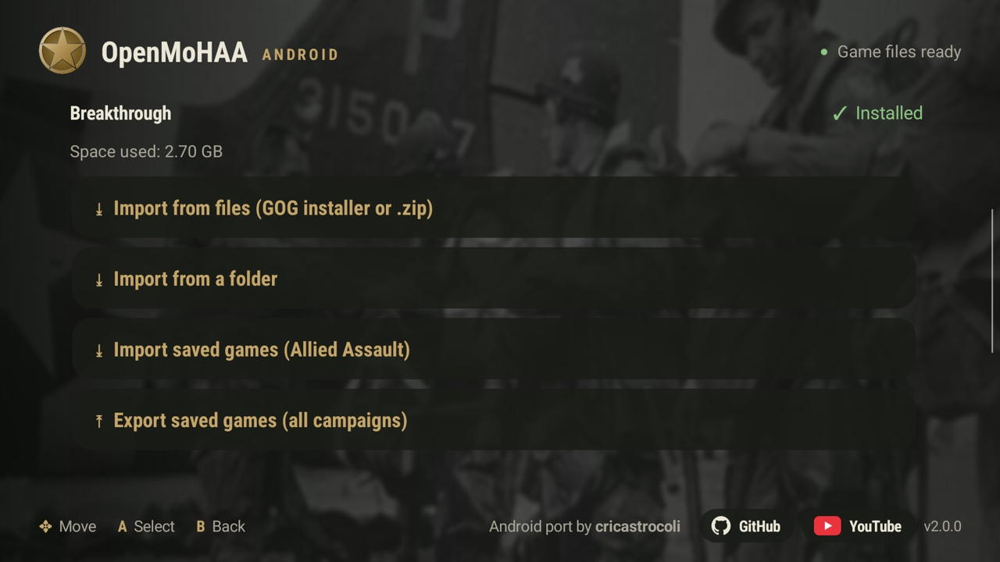
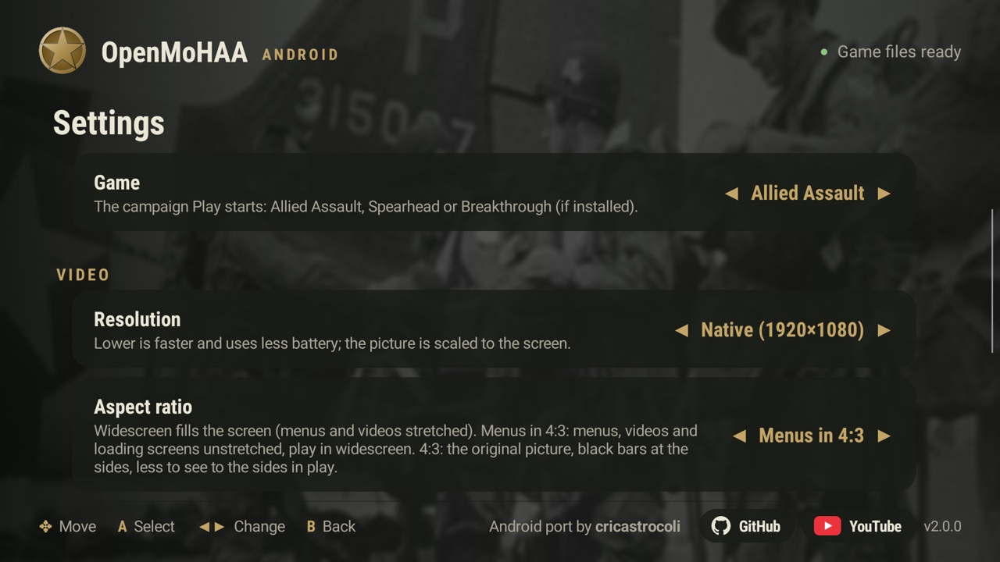

# OpenMoHAA Android

English · **[Português (Brasil)](README.pt-BR.md)**

**Medal of Honor: Allied Assault** on Android, for handhelds with physical controls, on the
free [OpenMoHAA](https://github.com/openmoh/openmohaa) engine. It comes with its own
launcher, which installs the game straight from the GOG installer, on the device itself: no
computer needed.


> The game's files are **not** included. You need your own copy of the original game
> (for example [Medal of Honor: Allied Assault War Chest on GOG](https://www.gog.com/en/game/medal_of_honor_allied_assault_war_chest)).

## Highlights

- 🆕 **Install straight from the GOG installer, on the device.** Download the Windows
  installer (the `setup_….exe` and its `.bin` files), pick them in the launcher, done: the app
  extracts the game by itself. On a Retroid Pocket 6 this takes about **70 seconds** for all
  three games (2.7 GB).
- 🆕 **Up to 120 FPS** on 120 Hz screens, with 30, 60 (default), 90, 120 or unlimited.
- 🆕 **The M1 Garand rifle reloads at any time.** In the original game it only reloads when
  its clip is empty; here it reloads like the other weapons, without losing rounds. Off by
  default, to keep the original behaviour; switch it on in **Settings** (campaign only).
- 🆕 **Refined analog aiming** for controllers: radial dead zone, response curve and a turn
  boost when the stick is held at its edge (for quick turns), with adjustable speed.
- 🆕 **Remappable buttons**: any action on any button, right in the launcher.
- 🆕 **Adjustable resolution**: native, 1600×900, 1280×720 or 960×540 (lower resolutions save
  battery; the picture is scaled up to the whole screen).
- 🆕 **Mods and translations**, imported through the launcher, switched on and off, a set per
  game.
- 🆕 **Spearhead and Breakthrough**: pick the campaign on the home page (LB / RB).
- Allied Assault, Spearhead and Breakthrough in one app, all three tested.

## New in this port

Everything below was made for this Android version:

### Launcher

- Home page with the chosen campaign, a summary of the settings and a background picture from
  a mission briefing, taken from your own game files.
- Fully usable with a controller (D-pad, A, B, LB / RB), and by touch.
- English and Brazilian Portuguese, following the device's language.
- Credits when the game starts.

### Game files



- 🆕 **GOG installer** (`setup_….exe` + `.bin`): extracted on the device with
  [innoextract](https://constexpr.org/innoextract/). Only the game's data folders (`main`,
  `mainta`, `maintt`) are taken. The app checks the free space first and tells you if a part
  of the installer is missing.
- The folder of an installed game (copied from a PC, for example).
- A `.zip` of the game's folder (or of its `main` folder).
- Importing again skips what is already there, so an interrupted import picks up where it
  stopped.

### Settings



| Option | Values |
|---|---|
| Game | Allied Assault, Spearhead, Breakthrough (the installed ones) |
| Resolution | Native, 1600×900, 1280×720, 960×540 |
| Frame rate | 30, **60** (default), 90, **120**, unlimited |
| Aim speed | 50% to 150% |
| Invert vertical aim | On / off |
| Reload the rifle at any time | On / **off** (default) |

### Controls


Defaults (every button can be changed on the **Controls** page):

| Button | Action |
|---|---|
| Left stick | Move |
| Right stick | Aim / look |
| RT | Fire |
| LT | Secondary fire / aim |
| A | Jump |
| B | Use (doors, mounted guns) |
| X | Reload |
| Y | Binoculars / item |
| LB / RB | Previous / next weapon |
| L3 | Crouch (press once to crouch, again to stand) |
| R3 | Walk (on / off) |
| D-pad ↑ | Grenade |
| D-pad ↓ | Holster weapon |
| D-pad ← / → | Lean left / right |
| Start | Menu |
| Select | Objectives |
| Select + LB / Select + RB | Quick save / quick load |
| Android Back button | Menu |

Crouch and walk are **toggles** rather than held, which is easier on a handheld.

In the game's menus the sticks move the pointer, **A** clicks, **B** / **Start** go back and
the D-pad works as the arrow keys. After a level loads, the pointer is already on the
**Continue** button.

### Mods and translations


- Import `.pk3` files, a `.zip` holding `.pk3` files, or a `.zip` of a mod's loose files
  (`global/`, `textures/`, `sound/`…). Zips laid out as `MyMod/main/…` work too: the launcher
  sorts the folders out, and each expansion's part (`mainta/`, `maintt/`) goes to the right
  game.
- Switch each mod on and off (A) or remove it (Y).
- Mods load over the game's files, in alphabetical order.

### Fixes in the game

- Saving: when the game can't save (no space, for example), it says so, instead of showing
  "Game saved" anyway.
- The game's message boxes are larger and readable on small screens.

## About touch controls

This port **has no touch controls**, by design. It is made for handhelds with physical
controls (such as the Retroid Pocket), where a 2000s first-person shooter, with precise
aiming, leaning, crouching and weapon switching, really works. On-screen buttons would cover
much of the picture and wouldn't give the same precision.

**On phones, use a USB or Bluetooth controller** (Xbox / Android layout). Touch works in the
launcher's menus.

## Requirements

- Android 8.0 or newer, 64-bit (arm64).
- A controller (built into the device, USB or Bluetooth).
- The original game files: the **GOG** version (War Chest, with both expansions) is the one
  tested.
- Free space: about 2.7 GB for the game and its expansions. To install from the GOG
  installer, the installer (about 2.5 GB) must be on the device while it installs; it can be
  deleted afterwards.

**Tested on:**

| Device | Chip | Result |
|---|---|---|
| Retroid Pocket 6 | Snapdragon 8 Gen 2 (QCS8550) | Native resolution, 120 FPS |
| Retroid Pocket 5 | Snapdragon 865 | Native resolution (1080p), steady 60 FPS |

Other devices with similar chips should work. Reports are welcome in
[Issues](../../issues).

## Installing

1. Download `OpenMoHAA-Android-1.0.0.apk` from [Releases](../../releases) and install it.
2. From your GOG account, download the **Windows** installer of *Medal of Honor: Allied
   Assault War Chest*: the `setup_medal_of_honor_….exe` and the `….bin` files. Keep them all
   in the same folder on the device (for example `Download`).
3. Open the app, go to **Game files → Import from files** and select **the `.exe` and all the
   `.bin` files** (touch and hold the first one to select several).
4. Wait for the bar to fill up, then press **Play**.

If you already have the game installed on a PC, you can also copy its folder (or a `.zip` of
it) to the device and use **Import from a folder** or **Import from files**.

> Android's folder picker doesn't let apps use the root of `Download` or of the storage (the
> "Use this folder" button doesn't show). Use a subfolder, such as `Download/MOHAA`, or select
> the files instead.

## Known issues

- Multiplayer hasn't been tested.

## Building from source

You need: the Android SDK with NDK 27.2.12479018 and CMake 3.31.6, JDK 17, `flex` and `bison`
(on macOS: `brew install flex bison`).

```bash
./scripts/fetch-sources.sh
```

```bash
cd android && ./gradlew assembleRelease
```

The APK lands in `android/app/build/outputs/apk/release/`. innoextract comes prebuilt in
`android/app/src/main/jniLibs/`; to build it again, run `native/build-innoextract.sh`.

The engine changes are on the
[`rp6-android`](https://github.com/cricastrocoli/openmohaa/tree/rp6-android) branch of the
OpenMoHAA fork.

## Credits

Android port by **cricastrocoli**, developed with the help of generative AI: **Claude**
(Anthropic) for the development, **DeepSeek** for reviewing the plan.

This project only exists thanks to:

- **[OpenMoHAA](https://github.com/openmoh/openmohaa)**, by the OpenMoHAA team: the free
  engine that recreates Medal of Honor: Allied Assault.
- **[emileb](https://github.com/emileb/openmohaa)**: OpenMoHAA's Android changes, and the gl4es
  fork used here.
- **id Software** and **[ioquake3](https://ioquake3.org/)**: the Quake III Arena engine
  OpenMoHAA builds on.
- **[SDL](https://www.libsdl.org/)**, **[OpenAL Soft](https://openal-soft.org/)** and
  **[gl4es](https://github.com/ptitSeb/gl4es)** (ptitSeb): video, input, audio and OpenGL on
  Android.
- **[innoextract](https://constexpr.org/innoextract/)** by Daniel Scharrer, with Boost, bzip2
  and xz: the GOG installer import.
- zlib, libjpeg (Independent JPEG Group), libogg and libvorbis (Xiph.Org), libmad and Recast
  Navigation.

Details and licenses in [THIRD_PARTY_NOTICES.md](THIRD_PARTY_NOTICES.md).

📺 The project on YouTube: [youtube.com/@cricas](https://www.youtube.com/@cricas)

## License

GNU General Public License, version 2 ([LICENSE](LICENSE)), like OpenMoHAA.

*Medal of Honor* is a trademark of Electronic Arts Inc. This project is not affiliated with or
endorsed by Electronic Arts and includes none of the game's files.
