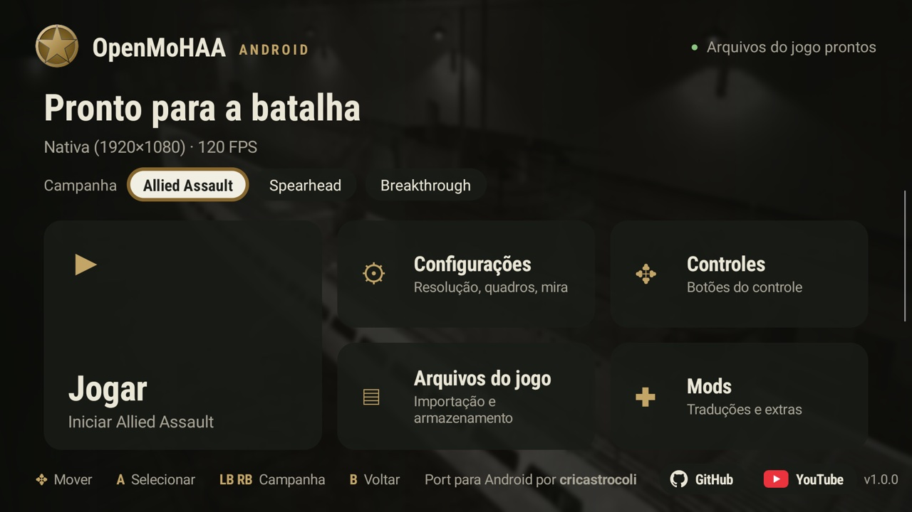
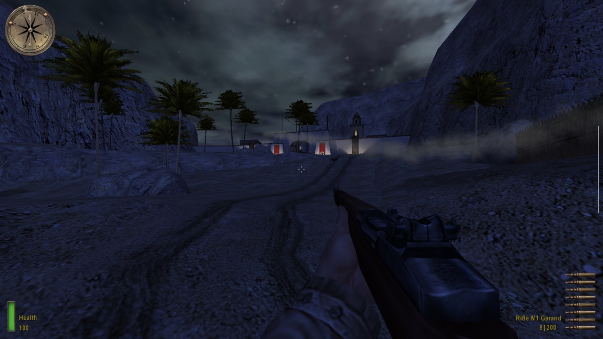
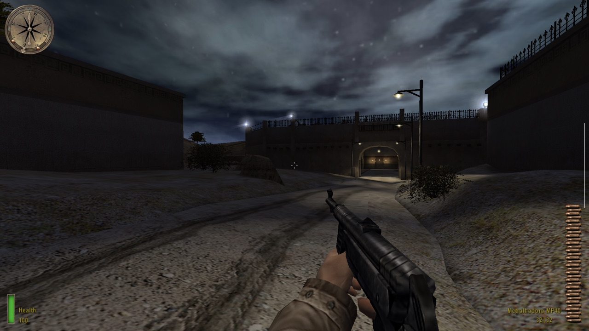
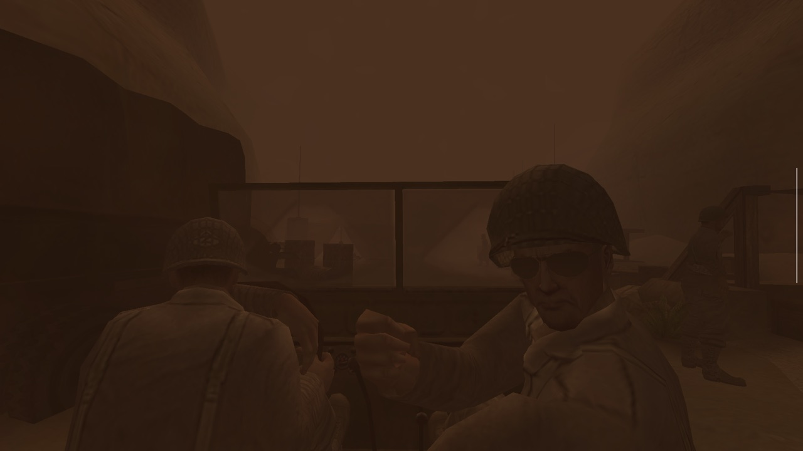
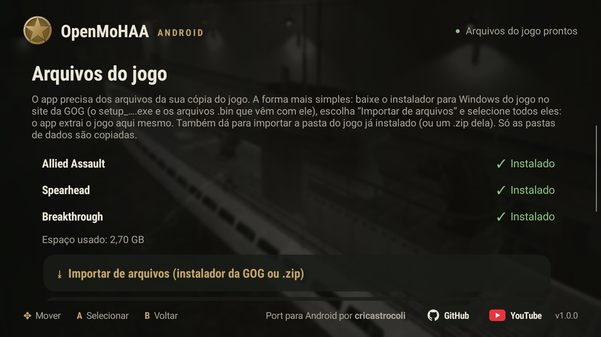
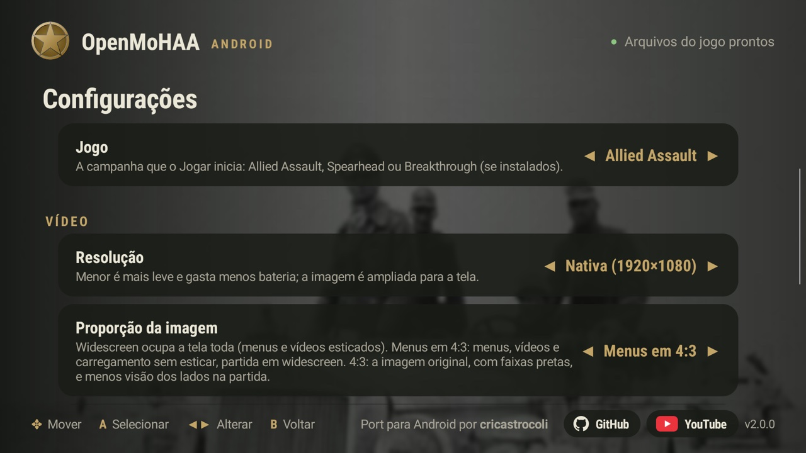
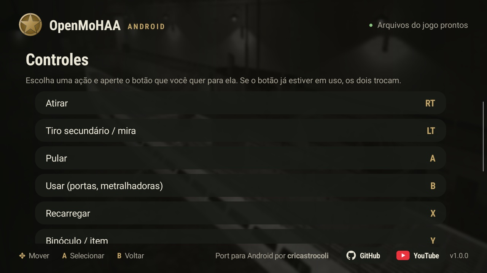
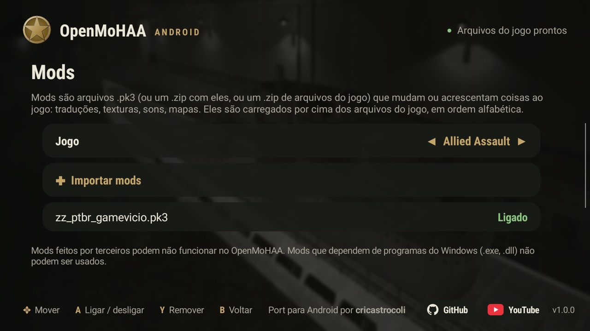

# OpenMoHAA Android

**[English](README.md)** · Português (Brasil)

**Medal of Honor: Allied Assault** no Android, em portáteis com controles físicos, com o
motor livre [OpenMoHAA](https://github.com/openmoh/openmohaa). Ele vem com um launcher próprio
que instala o jogo direto do instalador da GOG, no próprio aparelho, sem precisar de computador.



> Os arquivos do jogo **não** estão incluídos. Você precisa ter a sua cópia original
> (por exemplo, [Medal of Honor: Allied Assault War Chest na GOG](https://www.gog.com/en/game/medal_of_honor_allied_assault_war_chest)).

## Destaques

- 🆕 **Instalação direto do instalador da GOG, no aparelho.** Baixe o instalador para Windows
  (o `setup_….exe` e os arquivos `.bin`), escolha-os no launcher e pronto: o app extrai o jogo
  sozinho. No Retroid Pocket 6 isso leva cerca de **70 segundos** para os três jogos (2,7 GB).
- 🆕 **Até 120 FPS** em telas de 120 Hz, com opções de 30, 60 (padrão), 90, 120 ou sem limite.
  Acima de 60, o app pede à tela a taxa de atualização mais alta, e avisa se as configurações
  do aparelho a prendem em 60 Hz.
- 🆕 **O rifle M1 Garand recarrega a qualquer momento.** No jogo original ele só recarrega
  com o pente vazio; aqui ele recarrega como as outras armas, sem perder balas. Vem desligado,
  para manter o comportamento original; ative em **Configurações** (só na campanha).
- 🆕 **Mira analógica refinada** para o controle: zona morta radial, curva de resposta e
  aceleração ao manter o analógico no limite (para virar rápido), com velocidade ajustável.
- 🆕 **Botões configuráveis**: qualquer ação em qualquer botão, direto no launcher.
- 🆕 **Resolução ajustável**: nativa, 1600×900, 1280×720 ou 960×540 (resoluções menores
  economizam bateria; a imagem é ampliada para a tela inteira).
- 🆕 **Mods e traduções** com importação pelo launcher, ligar/desligar e um conjunto por jogo.
- 🆕 **Spearhead e Breakthrough**: escolha a campanha na tela inicial (LB / RB).
- 🆕 **Controles por toque** para celulares sem controle (opcionais, automáticos), e toque
  para escolher nos menus do jogo.
- Allied Assault, Spearhead e Breakthrough num só app, os três testados.

<p>
  
  
  
</p>

*Rodando no Retroid Pocket 6 (com a tradução para o português).*

## Novidades deste port

Tudo abaixo foi feito para esta versão Android:

### Launcher

- Tela inicial com a campanha escolhida, resumo das configurações e o fundo com uma imagem de
  briefing tirada dos seus próprios arquivos do jogo.
- Navegação completa pelo controle (direcional, A, B, LB / RB) e também por toque.
- Português (Brasil) e inglês, conforme o idioma do aparelho.
- Créditos na abertura do jogo.

### Arquivos do jogo



- 🆕 **Instalador da GOG** (`setup_….exe` + `.bin`): extraído no aparelho com o
  [innoextract](https://constexpr.org/innoextract/). Só as pastas de dados do jogo são
  copiadas (`main`, `mainta`, `maintt`). O app confere o espaço livre antes de começar e avisa
  se faltar alguma parte do instalador.
- Pasta do jogo já instalado (copiada de um PC, por exemplo).
- `.zip` da pasta do jogo (ou só da pasta `main`).
- Importar de novo pula o que já está igual, então uma importação interrompida continua de onde
  parou.
- 🆕 **Importar saves** de um PC ou de outro aparelho: os arquivos `.sav` (com os `.ssv` e
  `.tga`), ou um `.zip` da pasta `save`. As pastas `main`, `mainta` ou `maintt` do zip mandam
  cada save para o jogo certo.

### Configurações



| Opção | Valores |
|---|---|
| Jogo | Allied Assault, Spearhead, Breakthrough (os que estiverem instalados) |
| Resolução | Nativa, 1600×900, 1280×720, 960×540 |
| Taxa de quadros | 30, **60** (padrão), 90, **120**, sem limite |
| Velocidade da mira | 50% a 150% |
| Inverter mira vertical | Ligado / desligado |
| Recarregar o rifle a qualquer momento | Ligado / **desligado** (padrão) |

### Controles



Padrão (todos os botões podem ser trocados na página **Controles**):

| Botão | Ação |
|---|---|
| Analógico esquerdo | Andar |
| Analógico direito | Mirar / olhar |
| RT | Atirar |
| LT | Tiro secundário / mira |
| A | Pular |
| B | Usar (portas, metralhadoras) |
| X | Recarregar |
| Y | Binóculo / item |
| LB / RB | Arma anterior / próxima |
| L3 | Agachar (aperta uma vez agacha, outra vez levanta) |
| R3 | Andar devagar (liga / desliga) |
| Direcional ↑ | Granada |
| Direcional ↓ | Guardar a arma |
| Direcional ← / → | Inclinar para a esquerda / direita |
| Start | Menu |
| Select | Objetivos |
| Select + LB / Select + RB | Salvamento rápido / carregamento rápido |
| Botão Voltar do Android | Menu |

Agachar e andar devagar funcionam como **liga/desliga** em vez de segurar, que é mais
confortável num portátil.

Nos menus do jogo, o analógico move o ponteiro, **A** clica, **B** / **Start** voltam e o
direcional funciona como as setas. Depois de carregar uma fase, o ponteiro já aparece sobre o
botão **Continuar**.

### Mods e traduções



- Importe arquivos `.pk3`, ou um `.zip` com arquivos `.pk3` dentro, ou um `.zip` com os
  arquivos soltos do mod (`global/`, `textures/`, `sound/`…). Zips organizados como
  `MeuMod/main/…` também funcionam: o launcher arruma as pastas sozinho, e a parte de cada
  expansão (`mainta/`, `maintt/`) vai para o jogo certo.
- Ligue e desligue cada mod (A) ou remova (Y).
- Os mods são carregados por cima dos arquivos do jogo, em ordem alfabética.

**Tradução para o português:** a tradução da comunidade feita por **Jenner e MaxFox
(GameVicio)**, distribuída pela Central de Traduções, funciona com este port. Ela não está
incluída aqui, porque é trabalho dos autores dela. O instalador dela é um `.exe` para Windows:
abra-o com o [7-Zip](https://www.7-zip.org/) num computador, compacte a pasta `main` que está
dentro dele num `.zip` e importe esse `.zip` na página **Mods**.

### Correções no jogo

- Salvamentos: se o jogo não conseguir salvar (por exemplo, sem espaço), ele avisa, em vez de
  mostrar "Jogo salvo" mesmo assim.
- Caixas de mensagem do jogo maiores e legíveis em telas pequenas.

## Controles por toque

🆕 Para jogar no celular sem controle. No modo padrão (**Automático**) os controles na tela só
aparecem enquanto não há controle conectado: conecte ou pareie um, mesmo no meio da partida, e
eles somem. Dá para mudar na página **Controles**: Automático, **Sempre** ou **Nunca** (a tela
ignora toques, então um toque sem querer não faz nada).

- **Andar:** a parte esquerda da tela; o analógico aparece onde o polegar encostar.
- **Mirar:** arraste em qualquer ponto da parte direita, inclusive a partir dos botões.
  Arrastos lentos são precisos; movimentos rápidos giram mais, para virar depressa.
- **Botões:** atirar e mira (segurar), recarregar, granada, pular, agachar, usar, arma, item e
  menu. Atirar, mira e pular agem assim que tocados; os outros agem num toque, e um arrasto
  que começa neles gira a visão.
- **Menus:** toque no que quiser, como em qualquer app (também com controle conectado, a menos
  que o toque esteja em Nunca).

Um controle continua sendo o melhor jeito de jogar: a mira no analógico é mais precisa.

## Requisitos

- Android 8.0 ou mais novo, 64 bits (arm64).
- Um controle (embutido no aparelho, USB ou Bluetooth) é recomendado; em celulares sem
  controle, os controles por toque funcionam.
- Os arquivos originais do jogo: a versão da **GOG** (War Chest, com as duas expansões) foi a
  testada.
- Espaço livre: cerca de 2,7 GB para o jogo e as expansões. Para instalar pelo instalador da
  GOG, o instalador (cerca de 2,5 GB) precisa estar no aparelho durante a instalação; depois
  ele pode ser apagado.

**Testado em:**

| Aparelho | Processador | Resultado |
|---|---|---|
| Retroid Pocket 6 | Snapdragon 8 Gen 2 (QCS8550) | Resolução nativa (1080p), 120 FPS |
| Retroid Pocket 5 | Snapdragon 865 | Resolução nativa (1080p), 60 FPS estáveis |
| Samsung Galaxy S23 (Android 16) | Snapdragon 8 Gen 2 | Resolução nativa, tela em 120 Hz; instalado pelo instalador da GOG em cerca de 2 minutos |

Outros aparelhos com processadores parecidos devem funcionar. Relatos são bem-vindos nas
[Issues](../../issues).

## Instalação

1. Baixe o `OpenMoHAA-Android-….apk` mais recente na página de
   [Releases](../../releases) e instale.
2. Baixe da sua conta da GOG o instalador **para Windows** de *Medal of Honor: Allied Assault
   War Chest*: o `setup_medal_of_honor_….exe` e os arquivos `….bin`. Deixe todos na mesma
   pasta do aparelho (por exemplo, `Download`).
3. Abra o app, vá em **Arquivos do jogo → Importar de arquivos** e selecione **o `.exe` e
   todos os `.bin`** (toque e segure no primeiro para selecionar vários).
4. Espere a barra chegar ao fim e aperte **Jogar**.

Se você já tem o jogo instalado num PC, também pode copiar a pasta dele (ou um `.zip` dela)
para o aparelho e usar **Importar de uma pasta** ou **Importar de arquivos**.

> O seletor de pastas do Android não deixa escolher a raiz de `Download` nem do armazenamento
> (o botão "Usar esta pasta" não aparece). Use uma subpasta, como `Download/MOHAA`, ou
> selecione os arquivos.

## Problemas conhecidos

- O multijogador não foi testado.

## Compilar a partir do código-fonte

Precisa de: Android SDK com NDK 27.2.12479018 e CMake 3.31.6, JDK 17, `flex` e `bison`
(no macOS: `brew install flex bison`).

```bash
./scripts/fetch-sources.sh
```

```bash
cd android && ./gradlew assembleRelease
```

O APK sai em `android/app/build/outputs/apk/release/`. O innoextract já vem compilado em
`android/app/src/main/jniLibs/`; para compilar de novo, use `native/build-innoextract.sh`.

As mudanças no motor estão no branch
[`rp6-android`](https://github.com/cricastrocoli/openmohaa/tree/rp6-android) do fork do
OpenMoHAA.

## Créditos

Port para Android por **cricastrocoli**, desenvolvido com auxílio de IA generativa:
**Claude** (Anthropic) no desenvolvimento e **DeepSeek** na revisão do planejamento e do código.

Este projeto só existe graças a:

- **[OpenMoHAA](https://github.com/openmoh/openmohaa)**, da equipe OpenMoHAA: o motor livre
  que recria o Medal of Honor: Allied Assault.
- **[emileb](https://github.com/emileb/openmohaa)**: adaptações do OpenMoHAA para Android e o
  fork do gl4es usado aqui.
- **id Software** e **[ioquake3](https://ioquake3.org/)**: o motor do Quake III Arena, base do
  OpenMoHAA.
- **[SDL](https://www.libsdl.org/)**, **[OpenAL Soft](https://openal-soft.org/)** e
  **[gl4es](https://github.com/ptitSeb/gl4es)** (ptitSeb): vídeo, entrada, áudio e OpenGL no
  Android.
- **[innoextract](https://constexpr.org/innoextract/)**, de Daniel Scharrer, com Boost, bzip2
  e xz: a instalação pelo instalador da GOG.
- zlib, libjpeg (Independent JPEG Group), libogg e libvorbis (Xiph.Org), libmad e Recast
  Navigation.

Detalhes e licenças em [THIRD_PARTY_NOTICES.md](THIRD_PARTY_NOTICES.md).

📺 Apresentação do projeto no YouTube: [youtube.com/@cricas](https://www.youtube.com/@cricas)

## Licença

GNU General Public License, versão 2 ([LICENSE](LICENSE)), como o OpenMoHAA.

*Medal of Honor* é marca registrada da Electronic Arts Inc. Este projeto não tem afiliação
nem endosso da Electronic Arts e não inclui nenhum arquivo do jogo.
